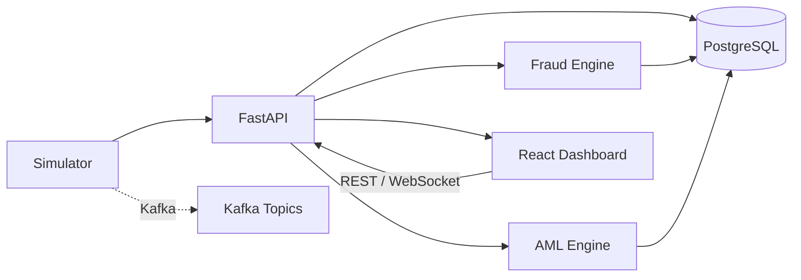

# Real-Time Fraud Detection & AML Monitoring Platform

A full-stack educational platform for monitoring synthetic banking transactions, identifying fraud risks, detecting AML indicators and managing investigations.

## Overview

The platform demonstrates:

- Synthetic transaction generation
- Rule-based fraud scoring
- AML pattern detection
- Fraud and AML alert management
- Investigation case workflows
- JWT authentication and role-based access
- PostgreSQL operational storage
- Kafka event-streaming configuration
- A React enterprise monitoring dashboard

## Key Features

- Batch and continuous transaction simulation
- Transaction validation and duplicate-event protection
- Decimal-safe monetary values
- Risk categories from Low through Critical
- Structuring, rapid movement, many-to-one and circular activity indicators
- Fraud alert and AML alert APIs
- Investigation cases, notes and audit records
- Responsive dashboard with charts and live data polling
- Docker Compose local deployment
- Swagger/OpenAPI documentation

## Technology

- React 18 and Vite
- FastAPI and Pydantic
- SQLAlchemy and Alembic
- PostgreSQL 16
- Kafka and Confluent Docker images
- JWT and bcrypt
- Chart.js
- Pytest
- Docker Compose
- GitLab CI

## Architecture

Fraud and AML results are suspicious-activity indicators, not findings or proof of criminal behaviour.

## Quick Start

### Prerequisites

- Docker Desktop with Compose v2
- Python 3.12+ for local backend testing
- Node.js 20+ for local frontend development

### 1. Configure environment

Copy-Item .env.example .env.local

Replace development secrets before using the project outside a local environment.

### 2. Start the platform

docker compose up --build

### 3. Open applications

- Dashboard: http://localhost:3000
- API documentation: http://localhost:8000/docs
- API health: http://localhost:8000/api/v1/health

## Demo Accounts

| Role | Email | Password |
|---|---|---|
| Analyst | `analyst@aml.local` | `Analyst123!` |
| Administrator | `admin@aml.local` | `Admin123!` |

Demo accounts are for local development only.

## Project Structure

text
backend/                 FastAPI application and tests
frontend/                React dashboard
transaction-simulator/   Synthetic transaction generator
database/                Migrations and seed data
kafka/                   Kafka topic documentation
snowflake/               Analytical export and SQL examples
hadoop/                  Optional batch-processing documentation
infrastructure/          AWS deployment guidance
docs/                    Architecture documentation

## Testing

Backend:

cd backend
python -m pytest -q

Frontend:

cd frontend
npm install
npm run build

Docker configuration:

docker compose config
docker compose build

## Data and Security

- All customer and transaction data is synthetic.
- Monetary values are stored as PostgreSQL decimal values.
- Passwords are hashed using bcrypt.
- APIs use JWT authentication and role checks.
- Database migrations provide transaction integrity and constraints.
- `.env.local` must remain excluded from Git.

## Current Scope

This repository provides a local MVP for a financial-crime monitoring workflow. Snowflake, Hadoop and AWS configurations are optional extensions and require real infrastructure and credentials before deployment.

Before public or production use:

- Replace demo credentials and JWT secrets.
- Configure HTTPS and restricted CORS origins.
- Complete durable Kafka consumer replay and offset management.
- Add production secrets management and monitoring.
- Deploy external analytics and cloud services.
