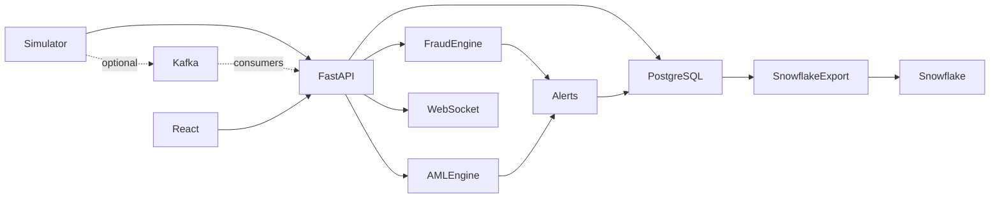

# Architecture

The transaction simulator submits REST requests in the baseline configuration and can publish JSON events to Kafka in the streaming configuration. FastAPI validates and persists transactions in PostgreSQL. Fraud and AML engines assess the committed transaction and create indicator records. Analysts access REST and WebSocket APIs through the React dashboard. PostgreSQL is the operational store; Snowflake receives analytical exports.

